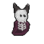

# 💀 Bonecharmer 
**Жанр:** Necromancy Army Builder / Pixel-Art Action  
**Платформы:** Android, Linux, Windows (Godot 4)

---

## 📖 Описание
Ты — **Заклинатель Костей**. Твоя задача — пробиться сквозь кладбища, собирая армию из поверженных врагов. 
В этой игре ты не просто сражаешься, ты создаешь легион. Каждое надгробие — это шанс, каждая кость — ресурс.

### 🕹 Геймплейные особенности
* **Сборка армии:** Поднимай скелетов прямо из-под земли.
* **Авторский стиль:** Чистый пиксель-арт с использованием ограниченной "средней" палитры.
* **Атмосфера:** Мрачное кладбище, пропитанное магией некромантии.

---

## 🎨 Визуал (Work in Progress)
 
*Наш главный герой — Bonecharmer*

---

## 🛠 Технологический стек
* **Движок:** Godot 4.6.4 (Compatibility Renderer)
* **Язык:** GDScript
* **ОС разработки:** Arch Linux 🐧
* **Графика:** Pixel-art (16x16 / 32x32 / 64x64)

---

## 🚀 Как запустить (для разработчиков)
1. Склонируйте репозиторий: `git clone https://github.com/tocnohnayu-oss/BoneCharmer`
2. Откройте проект в **Godot 4.6.2+**.
3. Нажмите **F5** для запуска.
